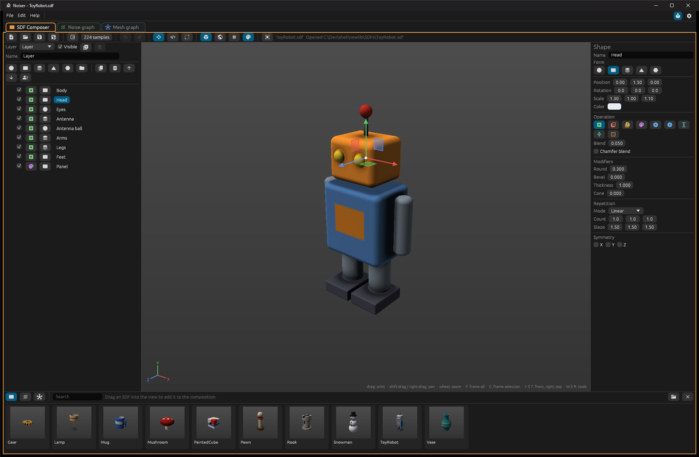
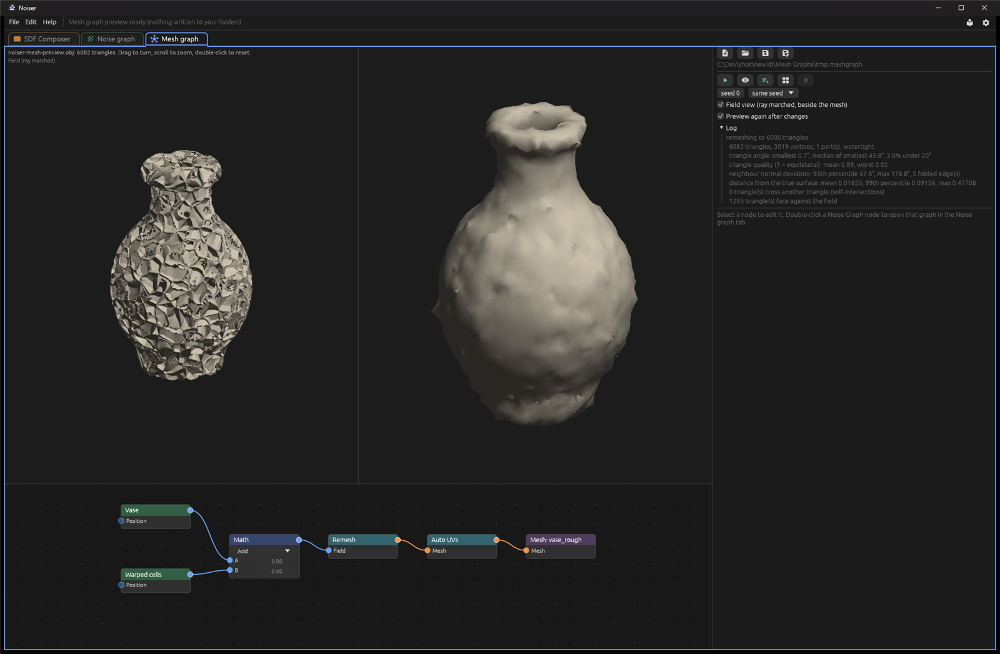
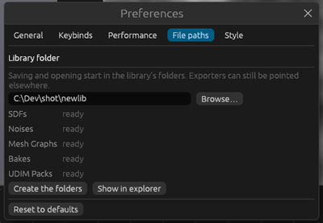

# Noiser

A node-based editor for **tiling 3D noise**. You build a graph of noises, patterns and math, watch it
as a raymarched shape and as a 2D slice while you work, and export it as 2D or 3D textures, an
OpenVDB volume, or a portable `.noiser` math-function file that other software can evaluate. The same graph can
also displace low-polygon meshes (single files or whole batches, from the app or a script) into high-resolution ones.

Everything is evaluated on the GPU (Rust, egui, wgpu). Resolution never limits the detail: the graph
stays a function, and exports sample it at whatever resolution you ask for.

The three tabs: the **SDF Composer** (build and edit shapes, with the library drawer along the bottom), the **Noise graph** (a Warped cells graph, with its 3D view and slice) and the **Mesh graph** (a vase from the Composer roughened by a noise graph, shown as the ray-marched field and as the remeshed result; no mesh file is needed, the Load SDF node is the only input).






> **Status: early and moving fast.** Windows only for now (a Vulkan or DX12 GPU is required).
> Releases are builds of whatever state the project is in at the time; see
> [Releases](../../releases) and the notes there.

## Running it

Download `noiser-windows-x64.zip` from the latest release, unzip it and run `noiser.exe`. To open a
graph straight away: `noiser.exe SimpleTestGraph.noisegraph` (an example is in the zip). The `examples` folder in the repository is a ready-made library: ten shapes for the SDF Composer (`SDFs`), ten noise graphs (`Noises`) and a mesh graph that roughens a vase with one of them (`Mesh Graphs`), each with the picture the drawer shows. Point Preferences > File paths at it (or copy it) and press Tab. The mesh graph's paths are relative, so keep the three folders together.

To build from source you need a recent stable Rust toolchain:

```
cargo run --release
cargo test          # unit tests, plus GPU tests that skip when there is no adapter
```

## What it does

**Tiling by construction.** One tile is the unit cube. Noises wrap their lattice, so a graph repeats
with period 1 on every axis whenever its frequencies and counts are whole numbers. Every node is checked, and
a node that breaks tiling gets an orange outline and says why in the details panel.

**Nodes**
- **Noise**: Perlin, Simplex, Worley and Blue/White. Worley has F1, F2, F2 − F1, a flat cell value or exact
  *cell edges*, a choice of Euclidean, Manhattan or Chebyshev distance, and a jitter control. Frequency, octaves,
  lacunarity, roughness, distortion, seed override, optional position input.
- **Patterns**: *Grid* (distance to the nearest cell centre or corner), *Bricks* (running bond or thirds, 2D
  or 3D), *Checker*, *Stripes*, *Dimples*, *Gyroid*, *Fractal* (Menger, Sierpinski), *Truchet* (arcs,
  diagonals) and *Honeycomb*, with Distance, Shape and Cell value outputs where they make sense.
- **Math**: add, subtract, multiply, divide, min, max, power, smooth min and max, dot product, absolute, ridge, floor, fraction, sine, square root, modulo, greater than. The
  operator is a dropdown on the node (the mouse wheel over it steps through them). A float with a vector
  gives a vector.
- **Separate XYZ** and **Combine XYZ** (take a vector apart, build one; domain warping is Position + a Combine of noises), **Remap** (with optional clamp), **Mix** (blend A into B by a factor), **Curve** (a response curve through up to 16 points; linear, smooth, step or cubic), **Value**, **Position** (X, Y and Z inputs, 1 by default, scale it; a scaled one has no `.noiser` form), **Radial position** (cylindrical or spherical coordinates around a centre and an axis you choose; breaks tiling), **Normal** (gradient of a field). Every noise, pattern and grid node has a second output, **Displacement**: its unit gradient times its value, a vector you can feed to Math or Combine. The numeric fields of those nodes (frequency, octaves, counts, amplitude, ...) each have a input-icon button that greys the field out and shows it as an input pin; a wired pin keeps tiling only when it comes from a uniform value (cyan pins and wires: Value, Random and what is computed from them) and, for a frequency or count, from a Value node holding a whole number; it has no `.noiser` form. **Random** gives one number between a min and a max from the seed (the same at every point; differs per node, or pin it with a seed override).
- **Outputs**: Density and Normal.
- Every Noise and Pattern node has an *amplitude* that multiplies its output (0.01 for a small warp offset, no Multiply node needed).
- Pins and wires are blue for floats and yellow for vectors. Node headers are green for generators (noise, patterns, grid), blue for math and shaping, grey for plumbing (values, position, separate/combine, reroutes) and purple for outputs.

**Layout.** The side panel has the viewport settings in tabs (3D view, Material, Lighting, Slice, Mesh) above the selected node's settings.

**Viewports.** A raymarched 3D view (solid, or cloud with a light) of a chosen shape displaced by the
graph, and a 2D slice view (any axis, grayscale or heatmap, with a 2 × 2 tile view to spot seams).
The eye in a node's header previews that node instead of the output.

**Speed.** Pipelines compile on a worker thread, so edits never freeze the UI. Any Noise, Math, Remap,
Grid or Bricks node can have a *cache* (button in its header): everything upstream is baked into a
tiling 3D texture for the preview, and the nodes it covers get a green outline. Exports ignore caches.

**Export**
- 2D image or 3D slice grid: PNG 8 or 16 bit, EXR 32 bit; density or normals.
- 3D OpenVDB (a float grid, written by Noiser's own minimal writer).
- 3D raw floats (`.raw`, 32-bit little-endian, x fastest; a `.raw.txt` note says the size), for tools that read volumes by hand.
- Shader code: File > Export shader code writes `noiser_density(p)` and `noiser_normal(p)` as HLSL, GLSL or WGSL (generated by naga from the preview's own shader, parameters and seed baked in; blue noise is not supported). The HLSL compiles with `fxc` as `cs_5_0`; the GLSL has not been run through a GLSL compiler here. From a script: `--export-shader out.hlsl`.
- `.noiser` math function: the graph as an op list plus test vectors, so a sampler in another host
  can check itself. The format is specified in [`docs/noiser-format.md`](docs/noiser-format.md), and
  [`tools/noiser_reference.py`](tools/noiser_reference.py) is a Python implementation of every noise kind written from that
  text (it matches the GPU to 1e-6), as a starting point for ports to other tools. A Blender
  extension that builds Geometry Nodes groups from it is in [`blender/`](blender) (math, remap, mix, linear curves,
  separate/combine, grid, normal, and Perlin, simplex, white and (default) worley noise so far; other nodes are reported as unsupported, and `blender/check_file.py`
  checks it against the file's own test vectors).

**Crash recovery.** Rolling backups; after a crash you are offered the last one on the next start. A panic is also written to `crash.log` in Noiser's data folder (`%APPDATA%\Noiser\data` on Windows); please attach it to bug reports.

**Meshes.** Import a low-resolution OBJ, PLY, STL, glTF or FBX (FBX is read in its own units and axes, with node transforms applied; UVs are kept; hidden meshes and all but the first level of a LOD group are skipped) (File menu, drag and drop, or `noiser.exe --mesh file.obj`) and it appears as the
*Mesh* shape in the 3D view, shaped live by your graph. *Export displaced mesh* then writes a high-resolution
OBJ or PLY of the same surface (as many samples along the longest side as you ask for), with small floating
bits removed and the mesh's own size and position restored. The mesh can be made of overlapping parts, and when it has several separate ones the Mesh tab says how they combine: *union* (the default), *intersect* (only where all overlap, for interior spaces), or *smooth union / smooth intersect* with a blend width (`--combine MODE --combine-smooth W` headless). A
*displacement mask* varies how strongly the noise acts on each part of the mesh, as a weighted sum of terms: a ramp
along an axis, which way the surface faces, occlusion, thickness, curvature, and a channel of the vertex colours
painted on the mesh (OBJ `v x y z r g b` lines or PLY red/green/blue). See `PLAN.md` for how it works and
its limits. *Show mask on the mesh* colours the preview by mask strength. Open surfaces (terrains, leaves, sheets)
work too: the side the normals face is outside, the other side is inside.

**Game meshes.** *Export displaced mesh* can also produce a game-ready mesh directly, with no high-poly mesh in between. *Remesh to N triangles* replaces the uniform grid mesh (a triangle for every sample) with an adaptive one: small, even triangles where the surface bends, large ones where it is flat, all lying on the exact displaced surface, from about 1,000 to 100,000 triangles. *UVs* unwraps it into an atlas of islands packed into the 0 to 1 square with no overlaps (xatlas, cut from a smoothed copy of the surface so a bumpy surface does not shatter into tiny islands; *best packing* is slower and fills the square better; it is on by default up to 50,000 triangles). *Bake maps* samples the maps straight from the displaced surface onto those UVs and writes 16-bit PNG files next to the OBJ: tangent-space normal (MikkTSpace, green down as Unreal expects; tick *green up* for Blender, Unity and glTF), occlusion, curvature, height above the low-poly surface, thickness and position. Islands are padded outwards so filtering does not bleed. Headless: `--remesh 20000 --uv --bake normal,occlusion --bake-size 2048`, and `--report` prints triangle quality, distance from the true surface and UV coverage. How it was built and what was measured is in `docs/game-mesh-plan.md`. The low-poly mesh has smooth normals computed from its own faces, the same ones an engine computes. Limits: the UVs are generated, not transferred from the input mesh; a surface with detail finer than its triangles keeps some tiny islands in hidden crevices; the amplitude of the noise limits what a given triangle count can follow (the maps carry the rest).

**Mesh graph.** The *Mesh graph* tab (next to *Noise graph* in the menu bar) is a second node graph for the whole game-mesh pipeline. *Load Mesh* makes a mesh file a field (its signed distance, in the units of the file; set *1 unit = N cm* on the node: 100 for metres, 1 for centimetres, so noise graphs, which work in metres, fit). *Noise Graph* uses a `.noisegraph` file as a node, with a frequency and an amplitude. Math, Normal, Dot, Lerp, Remap and the other noise-graph nodes work on those fields, so a rough and a smooth noise can be blended by how much the surface faces up and added to the mesh. Up to that point everything is still one field, compiled into one shader. *Remesh* turns a field into an adaptive triangle mesh, *Auto UVs* unwraps it (or *Transfer UVs* carries the UVs of an *Auto UVs* result (a coarser Remesh of the same field then shares its layout and maps: levels of detail) or of the mesh file, read from OBJ `vt` lines or glTF TEXCOORD_0 and exposed as a second output of Load Mesh, onto the remeshed mesh: corners take the UV of the closest point on the island under their triangle, so triangles are not stretched across seams; the interior of every island is then relaxed, with the borders held, to even out the stretch), *Bake* samples maps from the field onto it (a field wired into an extra Bake input becomes a custom map), *Split channels*, *Combine channels* and *Image levels* work on the maps (for example the red and green of a normal map with occlusion in blue), and *Mesh Output* and *Image Output* write OBJ, PLY or binary glTF (.glb, with normals and UVs) and 16-bit PNG files (an existing file with the same name is overwritten, so a rerun keeps its names). Wires are typed: orange meshes and pink images only connect to their own kind. *Run* executes the chain on a worker thread (*Cancel* stops it before the next node); *Save* (Ctrl+S) writes a `.meshgraph` file and refreshes the embedded copy each Noise Graph node keeps (the `.noisegraph` file stays the source of truth, and its copy is used when the file is missing). Double-clicking a Noise Graph node opens that file in the Noise graph tab. The mesh view lights the baked normal and occlusion maps on the mesh by default (software rendering; a menu above it picks smooth grey or any baked map unlit). Beside the mesh view, the *Field view* draws the displaced field of the first Remesh directly on the GPU by ray marching (no mesh is made), so a change in the graph or its noise shows after a moment, and it turns with the mesh view. *Bake* has a *samples* setting (anti-aliasing: the maps are baked at that many times the size per side and averaged down, normals as vectors). The remesher never lets a triangle pass through another (the log reports any that remain, which can only come from the starting mesh), and the *Maps* button shows each baked map full size (click a thumbnail; drag and scroll to pan and zoom). After a run the first mesh it wrote is shown above the graph (the *UV layout* button next to it shows the islands in the 0 to 1 square; drag to turn, scroll to zoom; faces turned away show dark red, which exposes folded triangles). `noiser.exe file.meshgraph` opens a graph in the tab (so "open with" works). Headless: `noiser.exe --headless --mesh-graph file.meshgraph`; add `--batch-dir SRC` (or `--batch-file`), or *Run on files…* in the tab, to run it once per mesh file: a Load Mesh node whose path is `{batch}` reads that file, and `{name}` in an output node's name becomes the file's name. A Noise Graph node can be *detached* to keep only the copy embedded in the mesh graph. Saving a graph file keeps the previous version in `<file>.history`. *UDIM pack…* (next to Run) is for after a batch: pick the meshes, a name and a folder, and it puts them in one UDIM tileset (rows of 10, in name order; tile 1001 first), copies each mesh's maps (`<mesh>_<map>.png` next to the mesh) as `<name>_<map>.1001.png` and so on, writes `<name>.obj` (every mesh laid out in a grid on the XY plane, Z up, one material called `<name>`) and each mesh again under its own file name (OBJ, or GLB for glTF; a PLY is written as OBJ) with its tile's UVs and that material. Normals are recomputed as smooth vertex normals. *Preview* shows the first Remesh at 6,000 triangles at most, without UVs or maps, for tuning the noise graphs. Limits: the view of the result is a simple software view, not a live preview of the field; at most four loaded meshes per graph; transferred UVs follow the source's seams, so a heavily displaced mesh still gets some stretched triangles near them.

**SDF Composer.** A third tab for building a shape from SDF primitives (sphere, cube, cylinder, prism, polygon) the way
SDF Modeler does: add, subtract, intersect and blend shapes in a tree of groups, with rounding, bevel, thickness, taper,
repeats and mirrors per shape. Every layer of the file is drawn at once in a ray-marched GPU viewport, in the colours stored in the file (the palette button in the toolbar switches them off); click a shape to
select it, then move, rotate or scale it with the gizmo (snapping and a uniform-scale handle included). Drag rows in the
hierarchy to reorder, move them into or out of groups, or drop one shape on another to group them. It reads and writes
SDF Modeler's `.sdf` files (0.6.x, without splines) and keeps what it does not edit, and it exports the composition as an
OBJ or PLY mesh. The shapes were matched against meshes exported from SDF Modeler itself
([`docs/sdf-modeler-notes.md`](docs/sdf-modeler-notes.md)). The tab's document is restored when Noiser starts again.

**Landscape.** A fourth tab (first step of [`docs/landscape-plan.md`](docs/landscape-plan.md)): a noise graph is the terrain. Its density output over one tile (x and y from 0 to 1) is the height, drawn in 3D (drag to orbit, scroll to zoom) and edited with the same nodes as the Noise graph tab (open and save `.noisegraph` files). *Size* and *height* are in metres; *fit the height range* stretches the output to 0..height. *Export heightmap for Unreal…* writes a 16-bit PNG at 4033 x 4033 (a valid Landscape size) and a `.json` with the location and scale to type into Unreal's Landscape import: the Z scale is chosen so the 16 bits cover exactly the terrain's height range. *Nanite chunks* cuts the terrain into chunks (default 500 m, so 4 x 4 for a 2 km terrain) and writes each as a regular-grid mesh of up to a triangle budget (default 1,000,000; GLB or OBJ, in centimetres, the chunk's corner at its origin) with planar UVs filling 0 to 1, plus its normal, ambient occlusion and curvature maps (named like the Mesh graph's: `Terrain_01_02_normal_base.png`) and a `Terrain_chunks.json` manifest with every chunk's location for placing them in Unreal. All chunks sample one height function at identical border positions and take their normals from it, so neighbours match exactly. With *also pack into a UDIM tileset* it then runs UDIM pack into a `UDIM` folder: the chunks with tile UVs and one material, the maps as `.1001` and so on, and a combined mesh made from light 128 x 128 stand-ins (a combined mesh at full detail would be millions of triangles) for texturing in Substance. A 4 x 4 export at the defaults took about 30 seconds and 2 GB. Erosion and masks are the next steps of the plan; `--landscape-tab` opens the tab at launch.

**Load SDF.** A node (Noise graph and Mesh graph) that reads a `.sdf` file and outputs its signed distance, negative inside,
for the position it is given: a live field, evaluated in the graph's shader, with no grid. By default the shape is fitted
into the unit tile (its longest side is `size`, its centre at `offset`); switch *Fit to the tile* off to keep the file's own
units and origin. A shape does not tile, so the node gets the usual warning. The file is read again when it changes. A
`.sdf` also loads as a mesh anywhere meshes do (the Load Mesh node, the Mesh shape in the Noise graph, drag and drop): it is
sampled on a grid and extracted with surface nets (the resolution is in Preferences > Performance); it keeps the file's own axes, Y up, which is how the graphs' views show it (the Composer's OBJ and PLY export is Z up, like SDF Modeler's). A relative path in the node is looked for in the folder of the graph file, so a graph and its shapes can be shared together. In the Mesh graph a lone Load SDF node is enough to tell Remesh where to look (no Load Mesh node is needed); the shape's box, plus a margin, is the domain.

**Batch.** Once a graph and settings look right on one mesh, *Batch displace meshes* applies them to many mesh
files (OBJ, PLY, STL, glTF, FBX) at once: pick the files and an output folder, choose the same seed for all, the global seed plus one per
mesh, or a repeatable random seed per mesh (the seed is in the file name), and start. Because every mesh is
scaled to a unit sphere first, the noise is the same size relative to each mesh. To work in real sizes instead, tick *noise in object units* in the Mesh section (or `--object-units` headless): one noise tile is then 1 unit of the mesh file (1 m for a mesh modelled in metres, and always for glTF, which is in metres; a glTF is read with its scene's node transforms applied, triangles only), the displacement is in the same units, and every mesh gets the same detail size whatever its size. A file that fails is
reported and the rest continue; nothing is ever overwritten. Without a window, see Headless below.

**Headless.** `noiser-batch.cmd graph.noisegraph --batch-out DIR --batch-dir SRC` (it runs `noiser.exe --headless`, waits for it and returns the exit code; `noiser.exe` itself is a windowed program that shells do not wait for) does the same without a window
(options: `--amount`, `--amount-var 0.2` (each mesh varies its displacement by up to 20 %), `--tile`, `--size`, `--seed`, `--seed-mode same|increment|random`, `--res`, `--grid-res`,
`--format obj|ply`, `--cull`, `--mask KIND`, `--manifest meshes.json` for per-mesh settings (a list of `{"file": ..., "amount": ..., "tile": ..., "size": ..., "seed": ..., "res": ..., "grid-res": ..., "cull": ..., "mask": [...], "params": {...}}`), `--set 3.scale=8` to override a node setting in the graph file, `--param name=value` to set a setting you named in Edit > Exposed parameters). Progress goes to the console and to `noiser-batch.log` in the output
folder; the exit code is 1 if any mesh failed. Without the .cmd, use `Start-Process -Wait -PassThru` in PowerShell.

**Editing.** Undo and redo, copy and paste of nodes (also between two Noiser windows), duplicate, reroute nodes (plain, and named ones that carry a value across the graph without a wire), mute (bypass) a
node with M, frame the selection with F or everything with Home, search in the add menu, Ctrl + right-drag to cut wires, Edit > Arrange nodes (a tidy left-to-right layout), File > New from template
(clouds, ridged mountains, cracked rock, brick wall, gyroid foam, warped cells), Open recent, drag a `.noisegraph` or `.obj` file
onto the window, comment frames, node labels, snap-to-grid, and a prompt before closing or replacing a graph with unsaved changes with unsaved changes (the window title shows an asterisk).
Edit > Preferences holds the interface scale, snapping and the backup switch; Help > Keyboard shortcuts lists the keys.
The preview has material settings (colour, specular, roughness, soft shadows), lighting presets with sun and sky controls, a render resolution (full, half,
quarter) and a march step limit; none of them affect exports.

**Library.** Set a library folder under Preferences > File paths (the Create the folders button makes `SDFs`, `Noises`, `Mesh Graphs`, `Bakes` and `UDIM Packs` in it). Open and Save dialogs then start in the matching folder, and bake, export and UDIM pack output defaults to `Bakes` and `UDIM Packs` (exporters can still be pointed elsewhere). A file saved into the library gets a small picture of the active view next to it (`name.sdf.png`), so the files themselves stay light. Press Tab (changeable in Preferences > Keybinds) in any tab for the library drawer: drag an SDF into the Composer to add it to the composition, onto the Noise graph view to use it as the mesh, or into the Mesh graph to make a node from it; double-click a card to open it.


**Preferences** have tabs for General, Keybinds, Performance (starting preview resolution and march steps, the resolution of `.sdf` meshes, the Composer's export samples), File paths and Style (scale, theme, accent colour).

## Controls

| | |
|---|---|
| Node graph | Middle-drag pans, scroll zooms, left-drag on empty space box-selects, right-click adds a node |
| | Drag from a pin to connect; drag a connected input away to disconnect; drop a wire on empty space to pick a node for it |
| | Delete removes the selection, Ctrl+D duplicates it at the cursor, Ctrl+C / Ctrl+V copy and paste, M mutes, F / Home frame, Ctrl+A selects all; drop a lone node on a wire to splice it in; Ctrl+S / Ctrl+O save and open |
| 3D view | Drag orbits, scroll zooms |
| Slice view | Scroll moves the slice; hovering shows the value under the pointer |
| SDF Composer | Drag orbits, Shift-drag or right-drag pans, scroll zooms; W / E / R pick the move, rotate and scale gizmo (the squares on the move gizmo move along two axes); Alt-drag a handle to drag a copy; F frames everything, C the selection, 1 / 3 / 7 look from the front, right and top; Ctrl+D duplicates, Ctrl+G groups |
| Library | Tab (changeable) opens the drawer; drag a card into the view; double-click opens it |

## Project docs

- [`PLAN.md`](PLAN.md): architecture, decisions, measurements and the roadmap.
- [`docs/noiser-format.md`](docs/noiser-format.md): the `.noiser` file format.
- [`docs/sdf-modeler-notes.md`](docs/sdf-modeler-notes.md): how SDF Modeler's `.sdf` files map to distance fields, and how that was measured.
- [`docs/pattern-nodes-plan.md`](docs/pattern-nodes-plan.md): the plan for more pattern nodes.

## Roadmap

Ideas: splines in the SDF Composer (files that use them show those parts missing), colours in the Load SDF node and in exported meshes, more pattern nodes, Linux and macOS builds.
See `PLAN.md` for the details.
