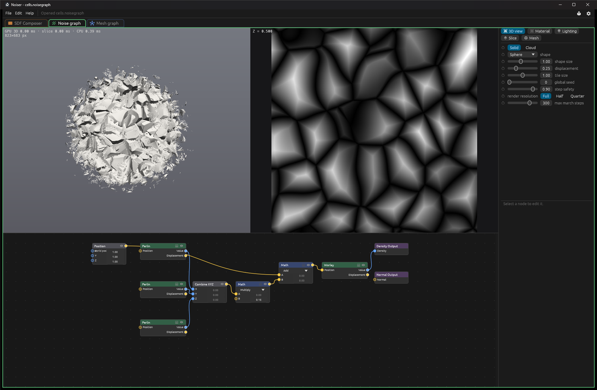
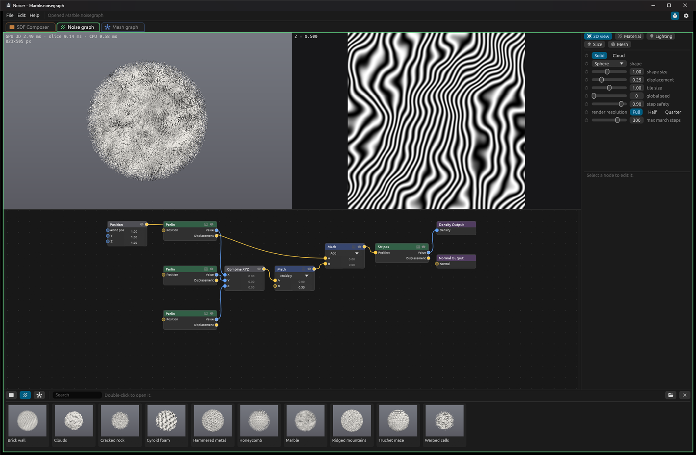

# Noiser

Noiser is a toolkit for math-based 3D content production, built around **signed distance fields (SDFs) and density fields**. In it, a shape, a noise, a terrain and a mesh are all the same thing: a function from a point in space to a value. You build those functions as graphs and compositions, combine them (add, blend, displace, warp), and only turn them into triangles, UVs and texture maps at the very end, at whatever resolution you ask for. Resolution never limits detail, because the field stays a function and exports sample it.

Everything is evaluated on the GPU (Rust, egui, wgpu). The name comes from where it started, a node editor for tiling 3D noise; the noise graph is still one of its parts, but it is now one field source among several. The name may change.


> **Status: early and moving fast.** Windows only for now (a Vulkan or DX12 GPU is required).
> Releases are builds of whatever state the project is in at the time; see
> [Releases](../../releases) and the notes there.

## What is in it

Four workspaces, switched from the menu bar (the mesh export panel lives inside the Noise graph workspace).

### Noise graph

A node graph that produces a density field. Noises (Perlin, Simplex, Worley, blue/white), patterns (grid, bricks, checker, stripes, dimples, gyroid, fractals, Truchet, honeycomb), math, remap, mix, curves, position and warp nodes, and a **Load SDF** node that brings a `.sdf` shape in as a field. It is shown as a raymarched 3D view and a 2D slice.

- Tiling by construction: one tile is the unit cube, and every node is checked and flagged when it breaks tiling.
- Exports: 2D/3D image grids (PNG 8/16 bit, EXR), OpenVDB, raw floats, shader code (`noiser_density(p)` as HLSL, GLSL or WGSL), a portable `.noiser` math-function file, and a Blender extension that builds Geometry Nodes groups from it.
- The graph can also displace a mesh file directly (the Mesh panel, single files or batches), see [Batch displacement](#batch-displacement).



### SDF Composer

Build a shape from SDF primitives (sphere, cube, cylinder, prism, polygon) in a tree of groups: add, subtract, intersect and blend, with rounding, bevel, thickness, taper, repeats and mirrors per shape. A ray-marched GPU viewport with a move/rotate/scale gizmo. It reads and writes SDF Modeler's `.sdf` files (0.6.x, without splines), exports the result as an OBJ or PLY mesh, and can show a reference mesh to model on top of. See [`docs/sdf-modeler-notes.md`](docs/sdf-modeler-notes.md).

### Mesh graph

A second node graph for the whole game-mesh pipeline, where the nodes pass fields, meshes and images.

- **Fields:** *Load Mesh* turns a mesh file into a signed distance field, *Load SDF* and *Noise Graph* nodes bring in Composer shapes and noise graphs, and math nodes combine them.
- **Mesh:** *Remesh* turns a field into an adaptive triangle mesh (about 1,000 to 100,000 triangles, lying on the exact surface); *Auto UVs* unwraps it (xatlas); *Transfer UVs* carries UVs from another mesh.
- **Maps:** *Bake* samples normal (tangent space), occlusion, curvature, height, thickness, position or custom maps straight from the field onto the UVs, with no high-poly mesh in between. Channel split/combine and levels nodes work on the maps.
- **Output and automation:** OBJ, PLY and GLB meshes, 16-bit PNG maps, batch runs over a folder of meshes, per-mesh seeds, and *UDIM pack* to gather a batch into one UDIM tileset.

Design notes and measurements: [`docs/game-mesh-plan.md`](docs/game-mesh-plan.md).


### Mesh panel (displace a mesh file)

In the Noise graph tab's side panel: import a low-resolution OBJ, PLY, STL, glTF or FBX and it is shaped live by your graph. *Export displaced mesh* writes a high-resolution OBJ or PLY, or a game-ready one with the same remesh, UV and bake steps as the Mesh graph. A displacement mask can vary the strength per part of the mesh (axis ramp, facing, occlusion, thickness, curvature, vertex colours).

### Landscape

A terrain workspace where a noise graph is the height function. Masks are painted on a map view and read in the graph with a Mask node; Slope and Noise Graph nodes pick where detail layers apply. Then:

- GPU hydraulic (pipe model) and thermal erosion on a 512 to 4096 working grid, with erosion presets (`.erosion` files in the library's Erosion Presets folder).
- *Export heightmap for Unreal*: a 16-bit 4033 x 4033 PNG plus a sidecar `.json` with the location and scale to enter in Unreal's Landscape import (Unreal can make that landscape Nanite itself).
- *Open as Nanite chunks in the Mesh graph*: the heightmap goes into a Mesh graph that cuts it into Nanite chunks, where shapes, caves and noise can be added before it is meshed.
- Terrain is saved as a `.landscape` project.

Plan and status: [`docs/landscape-plan.md`](docs/landscape-plan.md).

**Terrain with 3D shapes (new, rough edges):** in the Mesh graph, *Load Mesh* given a Landscape heightmap PNG is the ground. *Scatter on Terrain* plants copies of a Composer shape across it by a rule (spacing, density, size, slope, height; each kind with its own noise graph), *Remesh* cuts the result into chunks that match at their borders, and `tools/unreal_import_terrain.py` brings the chunks into Unreal as Nanite meshes with a terrain material. The whole path is in [`docs/terrain-workflow.md`](docs/terrain-workflow.md). *Scatter on Surface* does the same on any shape's surface (barnacles on a rock), where a mask built from nodes allows: the surface's Normal for tops only, another SDF for inside a shape, Position for a gradient.

## How the pieces fit

```
field  ->  mesh  ->  UVs  ->  maps  ->  engine
```

1. **Field.** A noise graph, a Composer shape, a mesh file (as its signed distance) or a terrain. Fields combine freely and are compiled into one GPU shader.
2. **Mesh.** Remesh extracts an adaptive triangle mesh from the field, at a triangle count you choose.
3. **UVs.** Generated (Auto UVs) or transferred from a source mesh, with levels of detail sharing a layout.
4. **Maps.** Normal, occlusion, curvature and others are baked from the field itself.
5. **Engine.** OBJ/PLY/GLB, 16-bit PNG maps, UDIM tilesets, Unreal heightmaps and Nanite chunks. For shaders, Blender and other tools, the field itself can be exported as code or as a `.noiser` file instead.

## Running it

Download `noiser-windows-x64.zip` from the latest release, unzip it and run `noiser.exe`. To open a graph straight away: `noiser.exe SimpleTestGraph.noisegraph` (an example is in the zip); `.meshgraph` files open the same way. Keep the `ml` folder next to `noiser.exe`: it holds the model files the Learned Detail node reads (`detail_16m_4m.nmlw`, `detail_4m_1m.nmlw`, `detail_sharpen.nmlw`; made by `tools/ml/export_weights.py`, not kept in the repository, so a release zip has to include them).

The `examples` folder in the repository is a ready-made library: ten shapes for the SDF Composer (`SDFs`), ten noise graphs (`Noises`) and a mesh graph that roughens a vase with one of them (`Mesh Graphs`), each with the picture the library drawer shows. Point Preferences > File paths at it (or copy it) and press Tab. The mesh graph's paths are relative, so keep the three folders together.



## Headless and batch

`noiser.exe` is a windowed program that shells do not wait for. `tools/noiser-batch.cmd` (shipped as `noiser-batch.cmd`) runs `noiser.exe --headless`, waits and returns its exit code. Progress goes to the console and to a log file in the output folder; the exit code is 1 if anything failed. Without the .cmd, use `Start-Process -Wait -PassThru` in PowerShell.

### Batch displacement

```
noiser-batch.cmd graph.noisegraph --batch-out DIR --batch-dir SRC
```

Options include `--amount`, `--amount-var`, `--tile`, `--size`, `--seed`, `--seed-mode same|increment|random`, `--res`, `--grid-res`, `--format obj|ply`, `--cull`, `--mask KIND`, `--combine MODE`, `--object-units`, `--manifest meshes.json` for per-mesh settings, `--set 3.scale=8` to override a node setting, and `--param name=value` for settings exposed in Edit > Exposed parameters. Game-mesh steps from the command line: `--remesh 20000 --uv --bake normal,occlusion --bake-size 2048`, and `--report` prints triangle quality, distance from the true surface and UV coverage. Nothing is overwritten.

### Mesh graph runs

```
noiser.exe --headless --mesh-graph file.meshgraph
```

Add `--batch-dir SRC` (or `--batch-file`) to run the graph once per mesh file: a Load Mesh node whose path is `{batch}` reads that file, and `{name}` in an output node's name becomes the file's name.

### Other startup flags

`--mesh FILE`, `--template NAME`, `--reference FILE`, `--landscape-tab`, `--mesh-tab`, `--export-shader out.hlsl` and a few more for scripting and screenshots; see `src/main.rs`.

## File formats

| | |
|---|---|
| `.noisegraph` | Noise graph |
| `.meshgraph` | Mesh graph (embeds a copy of each noise graph it uses) |
| `.landscape` | Landscape project (graph, settings, masks) |
| `.sdf` | SDF Composer shape, SDF Modeler compatible |
| `.noiser` | A graph as a portable math function with test vectors, specified in [`docs/noiser-format.md`](docs/noiser-format.md); [`tools/noiser_reference.py`](tools/noiser_reference.py) is a reference sampler |
| Mesh in | OBJ, PLY, STL, glTF, FBX, and `.sdf` |
| Mesh out | OBJ, PLY, GLB |
| Images | PNG (8/16 bit), EXR (32 bit) |
| Volumes | OpenVDB, raw 32-bit floats |
| Shaders | HLSL, GLSL, WGSL |

A Blender extension in [`blender/`](blender) builds Geometry Nodes groups from a `.noiser` file (a subset of nodes so far; unsupported ones are reported).

## Controls

| | |
|---|---|
| Node graph | Middle-drag pans, scroll zooms, left-drag on empty space box-selects, right-click adds a node |
| | Drag from a pin to connect; drag a connected input away to disconnect; drop a wire on empty space to pick a node for it |
| | Delete or X removes the selection, Ctrl+D duplicates, Ctrl+C / Ctrl+V copy and paste, M mutes, F / Home frame, Ctrl+A selects all, Ctrl+S / Ctrl+O save and open (all remappable in Preferences > Keybinds) |
| 3D view | Drag orbits, scroll zooms |
| Slice view | Scroll moves the slice; hovering shows the value under the pointer |
| SDF Composer | Drag orbits, Shift-drag or right-drag pans, scroll zooms; W / E / R pick move, rotate, scale; F frames everything, C the selection; Ctrl+D duplicates, Ctrl+G groups |
| Library | Tab opens the drawer; drag a card into the view; double-click opens it |

Help > Keyboard shortcuts lists the rest. Edit > Preferences holds the interface scale, keybinds, performance defaults, file paths and style. Setting a library folder under Preferences > File paths makes Open/Save dialogs and bake/export output start in matching subfolders. Rolling backups are kept, and a panic is written to `crash.log` in `%APPDATA%\Noiser\data`; please attach it to bug reports.

## Building from source

A recent stable Rust toolchain is needed.

```
cargo run --release
cargo test          # unit tests, plus GPU tests that skip when there is no adapter
```

## Docs and roadmap

- [`PLAN.md`](PLAN.md): architecture, decisions, measurements and the roadmap.
- [`docs/landscape-plan.md`](docs/landscape-plan.md): the Landscape workspace, erosion, chunks, what is still open.
- [`docs/game-mesh-plan.md`](docs/game-mesh-plan.md): remesh, UVs and baking.
- [`docs/noiser-format.md`](docs/noiser-format.md): the `.noiser` file format.
- [`docs/sdf-modeler-notes.md`](docs/sdf-modeler-notes.md): how SDF Modeler's `.sdf` files map to distance fields.
- [`docs/pattern-nodes-plan.md`](docs/pattern-nodes-plan.md): the plan for more pattern nodes.

Ideas: splines in the SDF Composer, colours in the Load SDF node and exported meshes, a Load Landscape node and adaptive terrain meshing, an Unreal import script, more pattern nodes, Linux and macOS builds.

## For scripts and agents

Everything runs from the command line without the app: `noiser --schema` (node kinds and settings), `--build spec.json out.meshgraph`
(a graph from a short name-based spec), `--validate`, `--describe`, `--headless --mesh-graph` (run) and `--preview` (a PNG of a noise
graph, `.sdf` or mesh). See [AGENTS.md](AGENTS.md), the specs in `examples/Specs/`, and the MCP server in `tools/mcp/`.
