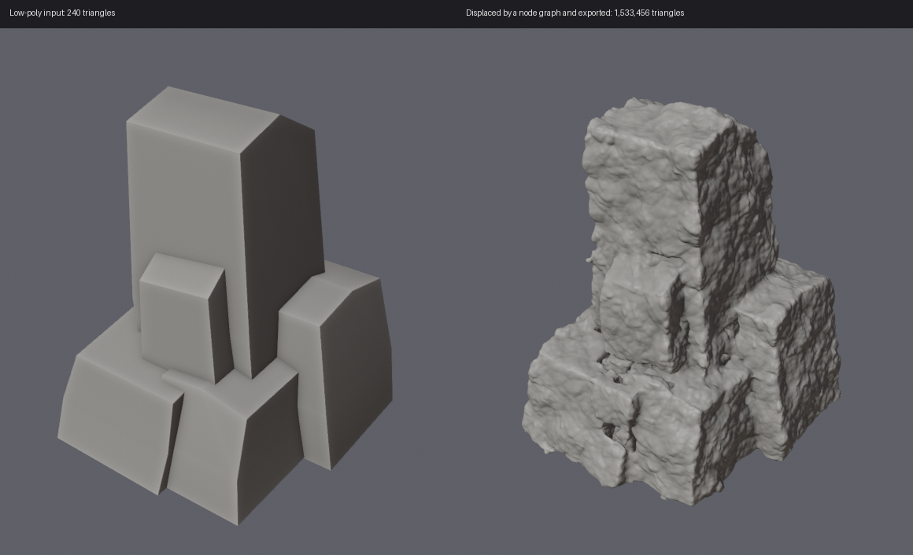

# Noiser

A node-based editor for **tiling 3D noise**. You build a graph of noises, patterns and math, watch it
as a raymarched shape and as a 2D slice while you work, and export it as 2D or 3D textures, an
OpenVDB volume, or a portable `.noiser` math-function file that other software can evaluate.

Everything is evaluated on the GPU (Rust, egui, wgpu). Resolution never limits the detail: the graph
stays a function, and exports sample it at whatever resolution you ask for.



> **Status: early and moving fast.** Windows only for now (a Vulkan or DX12 GPU is required).
> Releases are builds of whatever state the project is in at the time; see
> [Releases](../../releases) and the notes there.

## Running it

Download `noiser-windows-x64.zip` from the latest release, unzip it and run `noiser.exe`. To open a
graph straight away: `noiser.exe SimpleTestGraph.noisegraph` (an example is in the zip).

To build from source you need a recent stable Rust toolchain:

```
cargo run --release
cargo test          # unit tests, plus GPU tests that skip when there is no adapter
```

## What it does

**Tiling by construction.** One tile is the unit cube. Noises wrap their lattice, so a graph repeats
with period 1 on every axis whenever its scales and counts are whole numbers. Every node is checked, and
a node that breaks tiling gets an orange outline and says why in the details panel.

**Nodes**
- **Noise**: Perlin, Simplex, Worley and Blue/White. Worley has F1, F2, F2 − F1, a flat cell value or exact
  *cell edges*, a choice of Euclidean, Manhattan or Chebyshev distance, and a jitter control. Scale, octaves,
  lacunarity, roughness, distortion, seed override, optional position input.
- **Patterns**: *Grid* (distance to the nearest cell centre or corner), *Bricks* (running bond or thirds, 2D
  or 3D), *Checker*, *Stripes*, *Dimples*, *Gyroid*, *Fractal* (Menger, Sierpinski), *Truchet* (arcs,
  diagonals) and *Honeycomb*, with Distance, Shape and Cell value outputs where they make sense.
- **Math**: add, subtract, multiply, divide, min, max, power, smooth min and max, dot product, absolute, ridge, floor, fraction, sine, square root, modulo, greater than. The
  operator is a dropdown on the node (the mouse wheel over it steps through them). A float with a vector
  gives a vector.
- **Separate XYZ** and **Combine XYZ** (take a vector apart, build one; domain warping is Position + a Combine of noises), **Remap** (with optional clamp), **Mix** (blend A into B by a factor), **Curve** (a response curve through up to 16 points; linear, smooth, step or cubic), **Value**, **Position**, **Normal** (gradient of a field).
- **Outputs**: Density and Normal.
- Pins and wires are blue for floats and yellow for vectors.

**Viewports.** A raymarched 3D view (solid, or cloud with a light) of a chosen shape displaced by the
graph, and a 2D slice view (any axis, grayscale or heatmap, with a 2 × 2 tile view to spot seams).
The eye in a node's header previews that node instead of the output.

**Speed.** Pipelines compile on a worker thread, so edits never freeze the UI. Any Noise, Math, Remap,
Grid or Bricks node can have a *cache* (button in its header): everything upstream is baked into a
tiling 3D texture for the preview, and the nodes it covers get a green outline. Exports ignore caches.

**Export**
- 2D image or 3D slice grid: PNG 8 or 16 bit, EXR 32 bit; density or normals.
- 3D OpenVDB (a float grid, written by Noiser's own minimal writer).
- 3D raw floats (`.raw`, 32-bit little-endian, x fastest; a `.raw.txt` note says the size), for tools that read volumes by hand.
- `.noiser` math function: the graph as an op list plus test vectors, so a sampler in another host
  can check itself. The format is specified in [`docs/noiser-format.md`](docs/noiser-format.md). A Blender
  extension that builds Geometry Nodes groups from it is in [`blender/`](blender).

**Crash recovery.** Rolling backups; after a crash you are offered the last one on the next start. A panic is also written to `crash.log` in Noiser's data folder (`%APPDATA%\Noiser\data` on Windows); please attach it to bug reports.

**Meshes.** Import a low-resolution OBJ, PLY or STL (File menu, drag and drop, or `noiser.exe --mesh file.obj`) and it appears as the
*Mesh* shape in the 3D view, shaped live by your graph. *Export displaced mesh* then writes a high-resolution
OBJ or PLY of the same surface (as many samples along the longest side as you ask for), with small floating
bits removed and the mesh's own size and position restored. The mesh can be made of overlapping parts. A
*displacement mask* varies how strongly the noise acts on each part of the mesh, as a weighted sum of terms: a ramp
along an axis, which way the surface faces, occlusion, thickness, curvature, and a channel of the vertex colours
painted on the mesh (OBJ `v x y z r g b` lines or PLY red/green/blue). See `PLAN.md` for how it works and
its limits. *Show mask on the mesh* colours the preview by mask strength. Open surfaces (terrains, leaves, sheets)
work too: the side the normals face is outside, the other side is inside.

**Batch.** Once a graph and settings look right on one mesh, *Batch displace meshes* applies them to many mesh
files (OBJ, PLY, STL) at once: pick the files and an output folder, choose the same seed for all, the global seed plus one per
mesh, or a repeatable random seed per mesh (the seed is in the file name), and start. Because every mesh is
scaled to a unit sphere first, the noise is the same size relative to each mesh. A file that fails is
reported and the rest continue; nothing is ever overwritten. Without a window, see Headless below.

**Headless.** `noiser-batch.cmd graph.noisegraph --batch-out DIR --batch-dir SRC` (it runs `noiser.exe --headless`, waits for it and returns the exit code; `noiser.exe` itself is a windowed program that shells do not wait for) does the same without a window
(options: `--amount`, `--amount-var 0.2` (each mesh varies its displacement by up to 20 %), `--tile`, `--size`, `--seed`, `--seed-mode same|increment|random`, `--res`, `--grid-res`,
`--format obj|ply`, `--cull`, `--mask KIND`, `--set 3.scale=8` to override a node setting in the graph file). Progress goes to the console and to `noiser-batch.log` in the output
folder; the exit code is 1 if any mesh failed. Without the .cmd, use `Start-Process -Wait -PassThru` in PowerShell.

**Editing.** Undo and redo, copy and paste of nodes (also between two Noiser windows), duplicate, reroute nodes, mute (bypass) a
node with M, frame the selection with F or everything with Home, search in the add menu, Edit > Arrange nodes (a tidy left-to-right layout), File > New from template
(clouds, ridged mountains, cracked rock, brick wall, gyroid foam, warped cells), Open recent, drag a `.noisegraph` or `.obj` file
onto the window, comment frames, node labels, snap-to-grid, and a prompt before closing or replacing a graph with unsaved changes with unsaved changes (the window title shows an asterisk).
Edit > Preferences holds the interface scale, snapping and the backup switch; Help > Keyboard shortcuts lists the keys.
The preview has material settings (colour, specular, roughness, soft shadows), lighting presets with sun and sky controls, a render resolution (full, half,
quarter) and a march step limit; none of them affect exports.

## Controls

| | |
|---|---|
| Node graph | Middle-drag pans, scroll zooms, left-drag on empty space box-selects, right-click adds a node |
| | Drag from a pin to connect; drag a connected input away to disconnect; drop a wire on empty space to pick a node for it |
| | Delete removes the selection, Ctrl+D duplicates it at the cursor, Ctrl+C / Ctrl+V copy and paste, M mutes, F / Home frame, Ctrl+A selects all; drop a lone node on a wire to splice it in; Ctrl+S / Ctrl+O save and open |
| 3D view | Drag orbits, scroll zooms |
| Slice view | Scroll moves the slice; hovering shows the value under the pointer |

## Project docs

- [`PLAN.md`](PLAN.md): architecture, decisions, measurements and the roadmap.
- [`docs/noiser-format.md`](docs/noiser-format.md): the `.noiser` file format.
- [`docs/pattern-nodes-plan.md`](docs/pattern-nodes-plan.md): the plan for more pattern nodes.

## Roadmap

Ideas: exposed graph parameters for batch work, shader-code export of the density
function. See `PLAN.md` for the details.
