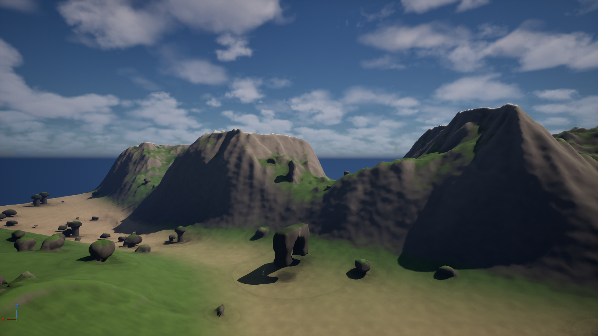

# From SDF shapes to a Nanite terrain in Unreal

The whole path, in the order you do it. Everything is a field until the last step, so you can go back to any stage and run
the later ones again.

```
SDF Composer      shapes (mushroom, boulder, arch, cave...)          .sdf files in the library
Noise graph       detail noises for each kind of shape               .noisegraph files
Landscape         layered terrain, painted masks, erosion            .landscape project -> heightmap PNG
Mesh graph        terrain + Scatter SDF nodes -> Remesh in chunks    chunk meshes + maps + terrain_chunks.json
Unreal            tools/unreal_import_terrain.py                     Nanite meshes, material, lit level
```

## 1. Shapes (SDF Composer)

Build each kind of object once and save it into the library's SDFs folder. The Composer's up is +Y; the terrain's is +Z,
and the Mesh graph turns shapes upright for you (the *Z is up* option, on for Scatter SDF).

* An object stands on its lowest point: build it with its base at the bottom.
* A cave, pit or tunnel is the shape of the **empty space**: build the volume and cut it out of the terrain later.
* Size does not matter: the Mesh graph scales every shape to the size you ask for.

## 2. Detail noise (Noise graph)

A noise graph that ends in *Density Output* roughens a surface when it is added to a shape. Make each kind of object its
own: warts for a mushroom cap, strata for a cliff, cells for a cave wall.

**Keep it gentle.** The noise is added to a distance field, and a distance field stays a surface only while its slope is
below about 1. A sine of amplitude *A* and wavelength *L* has slope 2*pi*A/L, so keep *A* under about a sixth of *L*, and less
with many octaves (each octave adds its own slope). Too much and the surface tears into floating pieces and the triangle
count explodes. The Mesh graph's Noise Graph node scales a graph by *frequency* (tiles per metre) and *amplitude* (metres).

## 3. Terrain (Landscape tab)

The terrain is a noise graph over one tile: x and y from 0 to 1, the density output as height. Layers are what you make of
them: a *Mask* node reads a mask you paint on the map view, *Slope* reads the ground's slope, and *Noise Graph* nodes bring
in other graphs, so `lerp(plains, mountains, Mask("range"))` is a mountain range exactly where you painted it. Set the size
and height, run *erosion*, and when the terrain looks right press **Open as Nanite chunks in the Mesh graph** and choose a
folder: the heightmap is written there and a ready Mesh graph opens.

Headless: `noiser --headless --landscape-export Terrain.landscape heightmap.png --erode`.

## 4. Chunks and shapes (Mesh graph)

The generated graph has the terrain (a *Load Mesh* node with the heightmap, in centimetres) feeding *Remesh* (the chunks),
*Auto UVs* (planar from above) and *Bake* (normal, occlusion, curvature maps), with *Mesh Output* and *Image Output* nodes.
Put things on the terrain between the terrain and Remesh:

* **Scatter SDF** plants copies of a shape by a rule. Drop it in the chain, pick the `.sdf`, and set the *cell* (about the
  spacing), *density*, *size* range, and where it may stand (*slope*, *height*). Wire another noise graph into its
  *Roughen* input and only these copies are roughened. Use one Scatter node per kind of object; chain them. Tick *cut out of
  the base* for caves and pits, and *face uphill* so a cave's chamber goes into the hillside and its mouth opens downhill (put
  the chamber at +Z of the shape in the Composer). A different *seed* plants the same rule somewhere else.
* **Load SDF** places one shape by hand (size, x and y; *Stand on the terrain* finds the height).
* A *Noise Graph* added to the terrain gives it grit.

*Remesh* has the triangles per chunk (1M is the largest size in Unreal's comfort zone) and the terrain's *chunks* setting
(per side) is on the Load Mesh node. Neighbouring chunks are cut from one lattice, so their borders match. Press **Run**, or
run it without a window:

    noiser --headless --mesh-graph DemoTerrain.meshgraph

A run writes `Terrain_<row>_<column>.obj`, the three maps for each, and `terrain_chunks.json`.

## 5. Unreal

Enable the *Python Editor Script Plugin*, then in the Output Log:

    py "tools/unreal_import_terrain.py" "<export folder>/terrain_chunks.json" /Game/NoiserTerrain /Game/NoiserTerrain/MyLevel

It imports the chunks as Nanite meshes, builds the terrain material (grass, sand, rock and snow by slope and height, with the
baked occlusion and curvature), places the chunks at the origin and lights the level. `tools/unreal_shots.py` takes
screenshots from a list of cameras for checking.

## Try it

The library has a finished example: `Terrains/DemoLandscape.landscape` (plains with hills and dunes, a painted mountain range;
open it in the Landscape tab), `Mesh Graphs/DemoTerrain.meshgraph` (the terrain with Scatter nodes for boulders, crags,
mushrooms, arches and caves, each with its own noise graph), and the shapes and noises it uses. Run the mesh graph, then the
Unreal script. `tools/demo/make_shapes.py` and the ignored test `write_demo_terrain` in `src/demo_scene.rs` regenerate all of it.



## Things to know

* **Unreal mirrors Y** when it imports an OBJ (it is left-handed), so the terrain sits at y from -size to 0, not 0 to size. The shapes look the same as in Noiser; only the coordinates differ.
* **Vulkan** is used when the machine has it. DirectX 12 compiles the shaders of a big graph for minutes (126 s for the demo's five Scatter nodes, against well under a second on Vulkan). `WGPU_BACKEND=dx12` forces the old behaviour.
* The ends of the terrain are open: the surface just stops at its square.

## Numbers that matter

* A chunk of 500 m at 1M triangles has triangles about 70 cm across: noise finer than about 4 m is not resolved.
* Extraction is fast (about a second per million triangles); the maps cost more (ambient occlusion at 4096 px about a minute).
* Units: the Mesh graph's field is in the units of the terrain's Load Mesh node: centimetres for Unreal.
